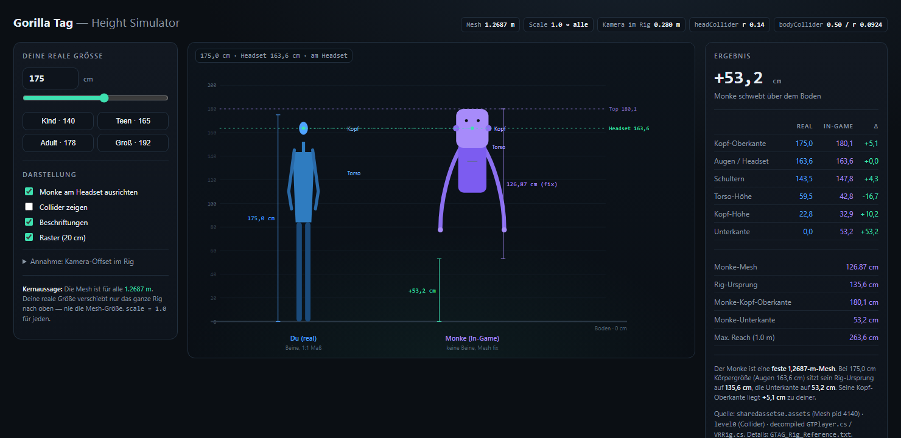

# Gorilla Tag — Rig- & Größen-Referenz

Fan-Projekt. Alle Maße aus dem **ausgelieferten Steam-Build** (Unity 6000.2.9f1)
gemessen, nicht aus dem Rip. Keine Affiliation zu Another Axiom.

**Live-Simulator:** https://tegmaram.github.io/gorilla-tag-rig-reference/



## Kernaussage

- **Alle Spieler sind gleich groß.** Mesh 1.2687 m · 0.6847 m breit · 0.3769 m tief.
  `scale = scaleMultiplier * nativeScale = 1.0` für jeden; `VRRig.ScaleUpdate()`
  setzt `localScale` jeden Frame auf `1.0` zurück.
- **„Größe" kommt nur aus dem Headset.** Das Rig wird an die Kamera gehängt
  (`syncPos = mainCamera.position + …`); es gibt keinen Zahlenwert für
  Spielerhöhe im Code (0 grep-Treffer).
- **Collider (echte Prefab-Werte):** `headCollider` Sphere r=0.14 ·
  `bodyCollider` Capsule 0.50 / r 0.0924.
- **Reichweite gedeckelt:** `maxArmLength = 1.0 m` (offizielles Repo: 1.5 m).
- **Größenänderung** nur über Map-Objekte (`NativeSizeChangerButton/Volume`),
  hart geclampt auf 0.1×–10× und serverseitig geprüft.

## Dateien

- `index.html` — interaktiver Höhen-Simulator (offline-fähig, keine Libraries)
- `docs/GTAG_Rig_Reference.txt` — vollständige Referenz (13 Abschnitte, mit
  Code-Belegen und Fan-Game-Checkliste)
- `tools/` — Reproduktions-Skripte (Python 3.12 + UnityPy 1.25.4)

## Reproduktion

```bash
pip install UnityPy
python tools/player_mesh.py "C:\...\Gorilla Tag_Data\sharedassets0.assets"
python tools/dump_tree.py   "C:\...\Gorilla Tag_Data\sharedassets0.assets" "Gorilla Player Networked" 6
python tools/dump_tree.py   "C:\...\Gorilla Tag_Data\level0" "GorillaPlayer" 3
python tools/world_bones2.py "C:\...\Gorilla Tag_Data\sharedassets0.assets" "rig"
```

Voraussetzung: installierter Gorilla-Tag-Build (Steam). Die decompilierten
Quellen liegen unter `re/decompiled/Assembly-CSharp.cs` im Install-Ordner.

## Hinweise / Annahmen

- `VRRig.headBodyOffset` konnte nicht aus dem Prefab gelesen werden (MonoBehaviour
  ohne Typetree / anderer Asset-Bundle). Kandidaten: 0.175 m (Head-Bone) oder
  0.28 m (fpv_camera_bone aus dem Rip). Der Simulator nutzt 0.28 m als Default
  und lässt sich verstellen.
- `GorillaPlaySpace.bodyColliderOffset` ist ein Runtime-Wert, nicht im Prefab.
- Vertex-Gruppen und Cross-Sections stammen aus dem Rip; Gesamtmasse sind
  build-verifiziert (Delta 0.4 mm).
- Der Rip ist vertikal um 0.209 m gegen die Build-Bones versetzt.

## Disclaimer

Nicht-affiliertes Fan-Projekt. Gorilla Tag und alle zugehörigen Assets sind
Eigentum von Another Axiom. Maße und Code-Auszüge dienen der technischen
Analyse; es werden keine Assets oder ganze decompilierte Dateien neu
veröffentlicht.
